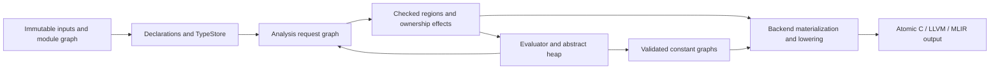

# Full Cell compile-time interpreter

Created: 2026-10-08. Revised: 2026-10-09.
Status: Draft / Proposed. Donald selected full interpreter design before a scalar
constant implementation on 2026-10-08. This document requests design review;
it is not an implementation plan or a claim of current language support.

## Intent and acceptance

Provide Zig-master-equivalent compile-time capabilities while preserving
Cell's syntax and ownership contracts. The installed reference is Zig
`0.18.0-dev.120+9fe22a29b`, its local language reference and the reproducible
inventory described in [ZIG-PARITY.md](../../ZIG-PARITY.md).

Compile-time execution must support ordinary Cell functions, control flow,
mutation, aggregate construction, type values, reflection and generic
specialization. Required compile-time execution produces a value or a source
diagnostic; it never silently becomes runtime execution. Language operations
have one checked semantic contract across phases and backends.

The compiler, evaluator, analysis and libraries ultimately reside in Cell.
A Zig bootstrap implementation is a migration stage. C runtime or host
compiler calls must not become permanent evaluator implementations. LSP
requests use the same analysis/evaluation services with cancellation and
bounded resources. Native macOS/Linux/Windows receipts remain required.

“Full” describes the intended subsystem and acceptance contract. Integer
constants alone do not satisfy it. Missing language constructs are explicit
prerequisites within this design's implementation program, not exclusions
from the user's parity goal.

## Current evidence and alternatives

The current AST has no compile-time expression, parameter phase, type value
or generic declaration representation ([ast.zig](../../../src/cell/ast.zig)).
The checker returns expression types without retaining a durable checked
expression product ([typecheck.zig](../../../src/cell/typecheck.zig)).
Existing [HIR](../../../src/cell/hir.zig) has typed slots and useful control
flow, but tolerates unresolved values and inserts C runtime calls for String
conversion, indexing and list construction. It is backend lowering, not a
safe compile-time execution contract.

| Approach | Tradeoff |
| --- | --- |
| AST interpreter with side tables | Smaller initial bridge; repeats resolution and conversion logic over pointer-based, untyped nodes. Type-producing evaluation still requires a semantic request system. |
| Execute current HIR | Reuses slots and branches; must first remove unresolved values, runtime/ABI coupling and cleanup artifacts. It occurs too late to produce generic types. |
| Strict checked semantic representation, shared by evaluator and backend lowering | More foundational work; explicit types, phase and ownership make one contract reusable for compiler, LSP and Cell self-hosting. Recommended. |

Reuse existing place/slot/control-flow concepts, rather than introducing
another ownership policy. Keep current backend gates passing throughout the
migration; route each construct through the shared representation only after
semantic equivalence is demonstrated.

## Verified integration boundaries and prerequisites

The following are source observations from the working checkout on 2026-10-09,
not execution receipts. Repository guidance includes historical claims that
predate the live module graph and integer work; the source below is the basis
for this revision. Recheck these boundaries before implementation.

| Boundary | Current source evidence | Required migration / acceptance gate |
| --- | --- | --- |
| Parser and AST | `parser.Parser.parseItem`, `parseFn`, `parseType`, `intFromPrev`, `floatFromPrev`; `ast.Item.Kind`, `TypeExpr`, `Expr.Kind`, `Param` | Add phase independently of ownership, module constants, dependent type expressions and lossless literal tokens. Extend dump, clone, visitors, pairing and error recovery together. Existing numeric AST stores `i64`/`f64`; merely adding evaluator big integers cannot recover lost input. |
| Checked program lifetime | `root.check` and `root.checkGraph` destroy `typecheck.Checker` instances; `Checker.checkExpr` returns arena-backed `types.Type` | Introduce a snapshot-owned checked result. No retained pointer may reference a destroyed checker, source arena or diagnostic bag. Keep old public check entry points as wrappers over the new service. |
| Type identity | `types.Type` is not interned, uses nominal names and structurally permissive `compatible` | Introduce `TypeId` and nominal `DeclId`; do not reuse recovery compatibility for executable type equality. Unknown/opaque recovery is not permission to evaluate or reflect layout. |
| Module and linkage identity | `load.Unit.identity`, `GraphBuilder.visit`, `symbols.decideSymbols`, `program.compose` | Keep canonical file identity, visibility and existing import-cycle refusal. Build stable declarations before C-symbol decisions; preserve source spans across composition. Import cycles remain `ImportCycle`, distinct from evaluator dependency cycles and legal function recursion within an acyclic graph. |
| Paired declarations | `load.merge` / `reportSignatureMismatch` compare current signatures and preserve interface visibility | Compare parameter phase and dependent signatures after binder normalization, including erased parameters; differing source parameter names alone must not change identity. A body may not widen visibility or erase a parameter absent in its interface. |
| Selected branches | `typecheck.Checker.checkExpr(.if_expr)` and `borrowck/expr.checkIf` eagerly visit both branches | Required evaluation must occur before these walks for phase-dependent regions. Feed the same selected checked region to type analysis, ownership and backend lowering; do not run the legacy whole-body checker over an unpruned generic template. Runtime requests still check both unknown paths. |
| Ownership facts | `borrowck.Checker.dropFacts`, `dropfacts.DropFacts`, `hir.lowerChecked` retain checker context and pointer-derived keys | Re-key facts by checked `BindingId` / `OpId` and snapshot ownership. Missing cleanup evidence may preserve a legacy runtime leak pin, but cannot justify an interpreter move, borrow, drop or freeze. No pointer key survives AST cloning, specialization or cache serialization. |
| Mutation | `typecheck.Checker.checkStmt` refuses indexed assignment; `ast.rootName` covers identifiers/fields | Index reads retain Optional results. Indexed writes need a language place model, alias checking and bounds semantics before the interpreter accepts them. Full aggregate mutation remains required, not implemented by an evaluator-only exception. |
| Backend routing | `main.loadForCompilation` checks graph, validates symbols, composes AST; `root.emitFor` sends C directly to AST emission and IR through HIR | Add a checked-program adapter for C and HIR. No backend may independently re-evaluate, re-resolve or re-specialize. Extend buffered output to C, including constant materialization failure. |
| Semantic target | `root.Target` is `{ c, llvm, mlir }`; `abi.layoutOf` implements measured AAPCS64 layouts with fixed sizes | Retain `--target` as backend selection. Add a separate target descriptor and explicit machine-target option; unsupported layout/ABI combinations fail before evaluation or emission. A host size or backend enum is not a cross-target layout contract. |

Source references: [parser](../../../src/cell/parser.zig),
[AST](../../../src/cell/ast.zig), [types](../../../src/cell/types.zig),
[checker](../../../src/cell/typecheck.zig), [root API](../../../src/root.zig),
[module loader](../../../src/cell/load.zig), [symbols](../../../src/cell/symbols.zig),
[composition](../../../src/cell/program.zig), [CLI](../../../src/main.zig),
[borrow branches](../../../src/cell/borrowck/expr.zig),
[drop facts](../../../src/cell/dropfacts.zig), [ABI](../../../src/cell/abi.zig).

Fixed arrays, vectors, payload enums/nested patterns, general pointers/slices,
arbitrary-width integer types, indexed writes, iteration, error propagation,
defer, local generated declarations and dependent generic signatures require
front-end/type/ownership contracts as well as evaluator operations. Their
absence is a prerequisite inventory, not permission to narrow full parity.
The builtin capability inventory also needs semantic reachability fixtures;
counting extracted Zig declarations is not such evidence.

## Surface language proposal

Add a `comptime` phase qualifier, orthogonal to ownership. These examples are
proposed syntax, not accepted programs today:

```cell
pub const copy answer: Int = comptime fib(10)

fn identity(comptime copy T: Type, copy value: T) -> T {
    return value
}

pub fn main() {
    let copy value: Int = identity(Int, answer)
    let copy generated: Int = comptime {
        var copy n: Int = 0
        while n < 4 { n = n + 1 }
        n
    }
}
```

`comptime expression` forces evaluation. `comptime { ... }` makes the block's
bindings and selected control flow compile-time; its tail is its value.
`comptime let` and `comptime var` request compile-time local bindings outside
such a block. A `comptime` parameter must receive a known value and is erased
from the runtime signature. Ordinary functions can execute in either phase.
`const` declarations require known initializers; ownership spelling and type
annotations follow existing Cell binding conventions. Immutable does not
mean implicitly copyable for resource-bearing values.

`Type` is a compile-time-only value category. Existing type names are values
only where a type value is expected; runtime attempts to store or pass a
`Type` fail. Expected `Type` admits a builtin or lexically resolved type declaration as a
value; lookup must not silently reinterpret a shadowing ordinary value as a
type. Dependent parameters are checked left to right after their preceding
compile-time parameters are bound. Types produced by evaluation can appear in annotations, function
signatures and instantiated declarations. Existing names, module visibility,
nominal identity, shadowing, and interface/body pairing remain authoritative.
Adding the new keyword requires an explicit diagnostic for an existing
identifier named `comptime`; no silent reinterpretation is allowed.

Use the ordinary module-qualified call syntax for compiler intrinsics:
`use std.meta`, then `meta.type_of(value)`, `meta.type_info(T)`,
`meta.type_from_info(info)`, `meta.field(value, name)`,
`meta.has_decl(T, name)`, `meta.compile_error(message)`,
`meta.compile_log(value)`, and `meta.set_eval_branch_quota(n)`.
`meta.instantiate(recipe)` explicitly creates a fresh owner from a frozen
resource recipe; it is never an implicit copy of an owning binding.
`use std.build` supplies `build.embed_file(path)` and target metadata.
Intrinsic identity belongs to compiler-provided canonical declarations;
a user function with the same spelling cannot acquire compiler privileges.
These source modules and the declared intrinsic registry must be inspectable.
Each intrinsic declares argument evaluation policy: `type_of` requests the
operand's checked type without executing its effects; ordinary value arguments
are evaluated left to right, once. Reflection cannot force an extern call
merely to inspect its declared return type. `compile_error` terminates the
selected request; `compile_log` records an ordered event. Compile-time phase
is not an effect annotation inferred from a function's name.

The parity matrix must map every installed reflection/type-construction
builtin to a Cell capability and fixture. The examples above name foundational
interfaces, not a closed enumeration of reflection functionality.

## Shared semantic architecture

`SemanticProgram` owns stable module, declaration, type, binding and operation
identities plus source provenance. Canonical declaration identity must be introduced above the existing module
graph, keyed by canonical unit identity plus declaration identity within that
snapshot, not a short name or emitted C symbol. Current `symbols.Entry` derives
its `canonical_name` from the emitted symbol; that string is an adapter input,
not the new identity authority. `TypeStore`
interns complete structural types while preserving nominal declaration
identity. A generated nominal type is identified by its declaration and
specialization, not merely an identical field list.

`analyze(declaration, specialization)` produces strict checked operations or
diagnostics. Each operation carries its type, phase, source span, resolved
references and ownership effect. Examples include conversion, index,
aggregate construction, call, move, borrow, retain and release. These remain
language operations; the backend later selects runtime symbols and ABI
representations. Error recovery may contain an unknown type, but executable
operations and materialized constants may not.

Analysis and evaluation cooperate through requests. Type expressions may
request evaluation, which may analyze a function instance or request a type.
Requests distinguish declaration identity, signature, body, type identity,
type completion, layout and value evaluation. State is unseen, pending,
completed or failed. Publish stable function/type identities and explicit
signatures before analyzing bodies. Recursive calls reuse those identities;
pointer-recursive nominal types can reference an incomplete type identity
without requesting its by-value layout. A cycle that requires an unavailable
completed value/layout/signature produces a diagnostic; an infinitely sized
by-value type is rejected. Inferred recursive signatures require an explicit
annotation when inference cannot complete. Ordinary recursive execution uses
interpreter frames and the evaluation budget, rather than declaration-cycle
failure. This rule applies to mutually recursive declarations too.

Semantic instance identities contain canonical declaration identity, explicit
compile-time arguments, runtime argument types, target and semantic version.
Forced evaluation has a separate identity containing every known argument
value that influences analysis, including ordinary function arguments. Keys
preserve nominal type identity and must not equate distinct mutable allocations.
Initially do not memoize arbitrary calls with mutable/ref/ARC arguments;
cache completed semantic instances and frozen immutable results with explicit
dependencies. Failed and cancelled requests never become completed cache entries.

Input dependencies are discovered during analysis/evaluation. Cache lookup
uses a preliminary request identity and stored dependency manifest, validating
all recorded inputs against one immutable compilation/revision snapshot before
reuse. Changed input starts a new snapshot; it does not mutate types already
published within an existing snapshot. Diagnostic logs are cached ordered
events replayed once per consuming top-level request, rather than silently
disappearing on a hit. Semantic identity and cache validity are separate.

Generated nominal identity includes generator source site, semantic instance,
captured compile-time environment and deterministic creation ordinal. Repeated
resolution of the same declaration request returns its published identity;
pure type-producing calls with the same canonical known arguments reuse a
stable type request identity, independent of the caller's source site or cache
eviction. Creation ordinals are local to that request's deterministic execution
path, not a global execution counter. Distinct generator sites, captured
environments or creation positions yield distinct nominal types even with
identical fields. Canonical structural constructors such as arrays
and pointer types instead intern by their full structural descriptor.

Each frame has an explicit phase environment: known compile-time values,
runtime slots, and unavailable/error states. A forced call binds all provided
arguments as known values; an ordinary runtime call binds only explicitly
compile-time parameters as known values. A branch is compile-time selected
exactly when its guard evaluates to a known Boolean/tag in that environment.
Writing a compile-time expression as a runtime call argument does not by
itself make the whole call compile-time.

Syntax and lexical binder structure are checked for the entire declaration.
For compile-time-selected branches, name resolution, type-dependent analysis
and ownership checking are performed only on the selected branch after
specialization, allowing a branch to reference operations/declarations
available only for its selected type/target. Runtime branches analyze
both paths and retain current ownership merge rules. Unselected branches
cannot expose declarations into the surrounding scope.
Checked semantic templates retain nonexecutable deferred region requests for
branches whose analysis depends on known values. The interpreter asks analysis
to check the selected region under its phase environment before executing any
operation in it. A deferred region is not an unresolved executable operation.
Runtime body requests check both unknown-guard regions; they never reuse a
body pruned for one forced invocation. Known short-circuit operands and match
guards use the same selection rule. Runtime control flow cannot mutate a
compile-time binding when its execution is not statically known.

## Interpreter and value model

`evaluate(request)` takes a checked entry/template, typed arguments, target, input
provider, resource budget and cancellation token. Its outcome is a value,
source diagnostic, cancellation or resource-limit error. Internally, explicit
control-flow outcomes distinguish ordinary values, return, labelled break and
continue; a return cannot escape a forced block into its runtime caller.

The interpreter supports short-circuit Boolean operators, guarded matches,
block tails, calls/recursion, loops, assignments, field/index operations,
structs, arrays/lists, vectors, enums with payloads, Optional and Result.
Features absent from today's AST/type system require their corresponding
language/type/ownership design and checked operations before evaluation.
The full acceptance matrix includes iteration, payload patterns, error
propagation, defer and generic/type-generating functions; it must not label
these implemented merely because an interpreter tag exists.

Checked calls carry explicit semantic parameter passing, separately from
target ABI representation. Preserve today's primitive by-value passing in
every ownership mode, including `exclusive Int`; mutation of that parameter
does not write into its caller. Aggregate exclusive references retain their
referent identity. Neither the evaluator nor the backend may infer universal
write-through from an ownership keyword alone. A future change to scalar
reference semantics requires a deliberate language/ABI migration and fixtures.

Values are explicit tagged data: arbitrary-precision compile-time integer,
compile-time float, fixed-width numeric, Boolean, enum/tagged value, aggregate,
function, type, abstract reference and resource handle. Preserve literal
spelling until numeric parsing into this model: current AST `i64`/`f64`
storage cannot represent the intended numeric parity. Numeric conversion,
overflow, shift, NaN and rounding contracts are target-aware. Host Zig integer
or floating arithmetic is not the specification. The eventual Cell arithmetic
implementation must reproduce the same answers from serialized fixtures.

The value model and evaluator require no physical C ABI layouts. Layout
reflection uses a target description and a layout service, independently of
host pointer size and ABI. Arbitrary-width integers, fixed arrays, slices,
pointers, address spaces, alignment, packed types and vectors must be reflected
when those language capabilities are implemented; unknown layout is an error.

## Proposed numeric and indexing contract

These are proposed language decisions, not claims about current runtime safety.
The fixed-width operations below must migrate with C, LLVM and MLIR before
runtime/evaluator agreement is claimed. Current C `codegen/expr.emitBinary`
emits native arithmetic operators, LLVM `Emitter.emitBinary` uses `add nsw`,
`sub nsw`, `mul nsw` and division instructions, and MLIR emits `arith` arithmetic.
These do not establish one checked-overflow contract. LLVM `fcmp one` and
MLIR `arith.cmpf one` for `!=` also differ from C's NaN inequality behavior;
this is a source-level discrepancy requiring a runtime regression probe.

| Operation | Proposed result / failure |
| --- | --- |
| Untyped integer literal and integer-only constant arithmetic | Exact arbitrary precision until an expected concrete integer type or runtime materialization is required. Unconstrained runtime integers default to `Int`; a value outside its range is `NumericRange`. Unary minus applies before range checking, admitting signed minimum literals. |
| Concrete integer conversion | Checked range; no silent truncation or signedness change. Existing distinct `Byte` and `UInt8` identities remain distinct. Explicit bit truncation/wrapping intrinsics are separately specified parity capabilities. |
| Concrete `+`, `-`, `*`, unary negation | Checked at the operation's width, signed or unsigned; overflow is `IntegerOverflow` during required evaluation and a checked runtime fault. Never inherit C undefined behavior, LLVM poison, or a debug/release difference. |
| Integer `/` | Truncate toward zero. Zero divisor is `DivisionByZero`; signed minimum divided by minus one is `IntegerOverflow`. Remainder/modulo require new syntax/intrinsic rules before use; do not infer a contract from Zig host operators. |
| `&`, `\|`, `^`, `~`, `<<`, `>>` | Preserve SPEC section 6: bit patterns at operand width, left shift truncates, signed right shift sign-extends, unsigned right shift zero-fills. Count is independently integer-typed and must satisfy `0 <= count < width`, else `InvalidShift`. Thus `Byte(128) << 1` is 0, not overflow; notation here describes typed values, not a proposed cast grammar. |
| Float literals / untyped arithmetic | Preserve source tokens and use explicitly defined IEEE binary128 round-to-nearest ties-to-even for the proposed compile-time float category; never host `long double`. Match this against the pinned Zig reference fixtures before parity qualification. Finite literals outside this format's range produce `NumericRange`. |
| Concrete Float32 / Float64 | Round each operation to the declared IEEE format, ties-to-even, with no contraction or fast-math reassociation. Preserve signed zero; arithmetic supports infinity and quiet NaN. Equality with NaN is false, inequality true, ordered relations false. Integer casts reject nonfinite/out-of-range operands; truncation toward zero precedes the range check. |
| Float identity in caches/constants | Value encoding preserves signed zero and explicit bitcast NaN payloads; arithmetic-generated NaNs have positive sign and canonical quiet encodings: binary32 `0x7fc00000`, binary64 `0x7ff8000000000000`, binary128 `0x7fff8000000000000000000000000000`. Encodings are most-significant-bit-first integer bit patterns, independent of target byte order. Any arithmetic operand that is a signaling NaN produces the canonical quiet NaN without a host trap; comparisons follow the same NaN truth table without raising an observable exception. Raw bitcasts and storage preserve signaling bits until a numeric operation consumes them. Cache equality uses encoding and type, not floating `==`. Backend lowering must obey the same canonicalization when bits are observable. |
| Integer/float and float-width conversion | Integer to float rounds once to the destination IEEE format, ties-to-even; finite overflow is `NumericRange`. Float widening is exact for finite values; narrowing rounds ties-to-even with gradual underflow (including signed zero), and finite overflow is `NumericRange`. Explicit infinities remain infinities across float widths. Numeric conversion of any NaN yields the destination canonical quiet encoding; only same-width bit-preserving operations preserve an explicit payload. Float to integer truncates toward zero, then checks the destination range; NaN/infinity fail `NumericRange`. |
| Existing String/list index read | Preserve the runtime reader's Optional contract: out-of-range returns `None`, in-range `Some(value)`; it is not an evaluator bounds diagnostic. Unsupported element representation is `UnsupportedCapability`. |
| Abstract reference projection / indexed write | Invalid or stale reference is `InvalidMemory`; an out-of-range write is `BoundsViolation`. Writes remain refused until the shared checked-place and ownership design lands. |

Concrete-typed arithmetic is never widened simply because it executes at
compile time. Expected type propagation must be explicit in checked conversion
operations; `Int8(127) + Int8(1)` fails even inside a block later converted to
`Int`. Untyped `127 + 1` can become `Int16(128)` but cannot become `Int8`.
Literal parsing, float casts/bitcasts and the final widths above need golden
serialized value fixtures; selecting a bootstrap big-number implementation
does not define their semantics. No production dependency is chosen here.

## Compile-time memory and Cell ownership

`ComptimeHeap` uses allocation identities and generation counters. A place
consists of allocation identity and field/index projections. References carry
access mode and lifetime; never expose a host pointer. Frames own binding
slots. Move invalidates the source; initialization/revival follows Cell's
checked ownership rules. ARC uses abstract handles and deterministic retain/
release effects. Scope exit, jumps, returns and failure paths release owned
interpreter resources, including allocations created during failed analysis.

Static ownership rules remain authoritative, including current R8 borrow
escape refusals and named-loan NLL boundaries. Executed operations also check
generation, initialization, bounds and access invariants. Compile-time
execution does not grant permission to accept a borrow that runtime Cell
refuses. Specializations are checked after type/branch selection, with source
and specialization provenance attached to diagnostics.

`freeze(value)` produces an immutable `ConstantGraph` only if the value has no
runtime dependence, frame-local reference or mutable escaping alias. A
compile-time pointer can become a runtime relocation only when its referent
is stable immutable promoted storage and its type/ownership contract permits
that reference. Cyclic or resource-bearing graphs require explicit supported
materialization; unsupported forms fail rather than serialize host addresses.
Freeze is an atomic deep copy into program-owned immutable storage with
allocation/projection relocation remapping. Publish the graph only after
every edge and ownership constraint passes validation. On success, original
frame allocations remain frame-owned and are cleaned normally; on failure,
discard the unpublished graph and preserve original cleanup responsibility.
Published graph references therefore survive frame teardown without borrowing
the original evaluator allocation. Copying during freeze is compiler storage
management, not an implicit source-language resource copy.

Deduplicating immutable constant bytes is distinct from sharing an owning
buffer. Scalar/type/immutable-view constant uses copy their value or stable
reference under existing copy rules. Every resource-bearing value exported
from an explicit forced expression/block, or a required module-constant
initializer, becomes a compile-time-only `Frozen<T>` recipe. This is a rule
about the phase boundary, independent of whether its consumer is a binding,
assignment, argument, return, aggregate element/field, branch/match tail or
another forced expression. A module constant's annotation specifies payload
`T`; this declaration-specific rule does not make a local `owned T` annotation
accept a recipe. There is no implicit recipe-to-`T` conversion in either phase.
An expected owning type must not trigger materialization or change this rule. An explicit
`meta.instantiate(recipe)` operation produces a fresh owning graph on each
invocation. An explicit ARC conversion may box that fresh owner using checked
retain/release rules. Compile-time code can inspect a frozen recipe immutably
or explicitly instantiate it into evaluator-owned storage; it cannot move the
recipe as if it were an owner. No general borrowed-return or stored-borrow
exception is introduced for constants: R8 remains binding. Runtime immutable
views require a supported existing view representation and promoted storage
contract; otherwise refuse. Multiple instantiations cannot acquire owners of
one allocation through constant interning. This policy must be visible in
checked operations and borrow checking, not a backend-only duplication trick.
Every backend must implement a materialization case or refuse it before
emitting any output.

Inside an active evaluator frame, ordinary calls, returns, local bindings and
mutations operate on owning `T` values with normal move/borrow/drop rules.
`comptime let` / `comptime var` outside an explicit block create evaluator-local
bindings in the surrounding checked region's phase environment; they do not
freeze on every assignment. Such live owners cannot cross into runtime use.
Exporting them through a forced expression freezes them under the rule above.
In contrast, `comptime make_list()` is an explicit freeze boundary even inside
another evaluator frame: the result is `Frozen<[Int]>`, and an owning consumer
must explicitly instantiate it. A recipe passed through a forced expression
remains the same immutable recipe, not `Frozen<Frozen<T>>`.

For example, `let owned xs: [Int] = comptime make_list()` fails
`FrozenRecipeUse`; `let owned xs: [Int] = meta.instantiate(comptime make_list())`
creates a runtime owner. Within a forced block, `meta.instantiate(recipe)`
creates an evaluator owner; exporting that owner from the block freezes it
again. A direct return or argument expecting `[Int]`, a list element expecting
an owning list, and a struct field expecting an owning payload follow exactly
the same rule. Bind a recipe with `comptime let copy recipe = comptime
make_list()` when it must be named; copying its immutable recipe handle does
not copy an owner. `meta.instantiate` consumes a known recipe handle without
consuming the recipe and returns a fresh `T` in the operation's execution phase.
Recipes cannot be stored in runtime aggregates or passed as runtime parameters;
compile-time parameters may accept them by recipe identity. Unsupported resource
graphs fail at freeze or explicit instantiation, never on a hidden conversion.

## Effects, budgets and diagnostics

Allow deterministic operations on evaluator-owned memory. Reject ordinary
extern calls, OS I/O, clocks, randomness, process creation, networking and
runtime global mutation during evaluation. Declared compiler services provide
read-only build inputs such as embedded bytes. Canonical path, content hash
and target/configuration become dependency records; undeclared input access
fails. Compile logs are ordered diagnostic events, not arbitrary host output.

Default limits per top-level request: 1000 backward branches, 1,000,000
operations, 256 call frames, 64 MiB live evaluator storage, 100,000 live
allocations and 10,000 specializations. All are independently checked and
configurable by the invoking compiler/analysis service. Backward-branch quota
can be raised explicitly through `meta.set_eval_branch_quota`; it cannot override
host resource caps. Nested calls, semantic requests and specializations share
the top-level budget instead of resetting it. Charge numeric/type construction,
dependency input bytes, generated semantic nodes, diagnostics and cache growth
before allocating; a huge single integer shift/type construction must not
bypass the memory cap merely because it counts as one operation. Limits and
target form part of the request configuration.
Charge operand-size-dependent work across arithmetic, layout, interning,
freezing, hashing and input services to the same operation budget. Long
primitive loops and input reads poll cancellation at least every 1024 units of
work or 64 KiB of input. Declared input services enforce byte limits before
reading/allocation. Program-owned results and caches have a separate default
256 MiB service cap; evict unused snapshot/cache entries before admitting new
storage, or report a resource-limit diagnostic when active results prevent
eviction. Cancelled/obsolete LSP revisions release their temporary request
storage; pinned results are charged until their snapshot is released.
Cancellation is checked at request dispatch, calls, backward branches and
allocation. Compiler and LSP must never return a partial value on exhaustion.

Diagnostics identify the failing operation, forcing site, declaration/input,
and bounded call/instantiation stack. Include errors for unknown runtime
values, forbidden effects, invalid casts/layout, arithmetic faults, invalid
memory access, dependency cycles and each exceeded limit. Sort diagnostics
deterministically by request/source identity, independent of worker completion
order. Failed requests roll back their temporary storage and cache entries.

## Parity, integration and self-hosting qualification

Create explicit contracts from the installed Zig inventory for comptime
expressions/variables/parameters, type values, type creation/reflection,
specialization, inline control flow, numeric operations, pointer/aggregate
constants, target/layout queries, compiler diagnostics, branch quota and
declared input services. For each: accepted program, exact result, refused
program, exact failure class, and platform/backend qualification.
Capabilities not yet implemented remain Proposed or Partial in the matrix.

Compare ordinary runtime execution and compile-time evaluation of the same
pure function. Add differential Zig/Cell fixtures where semantics correspond;
record deliberate Cell ownership/syntax differences instead of treating
identical source spelling as parity. Exercise runtime-dependent refusal,
unselected type-specific branches, recursive functions and declaration cycles,
module privacy/shadowing, every jump/cleanup path, borrow escape, nested
aggregate mutation, alias generations, numeric boundaries and constant
materialization. Each resource limit and cancellation needs deterministic
failure/cleanup tests. Run the repository's full gate after each integration.
Include direct/mutual function recursion, pointer-recursive generated types,
impossible by-value layout and cyclic constants. Evaluate the same Boolean
branching function with both values and subsequently request its runtime body.
Test repeated type creation at one site versus distinct sites, dependency
snapshot changes, log replay, direct repeated consumption of a frozen recipe
(refused), explicit repeated instantiation (independent owners), relocation
survival after frame cleanup and failed freeze cleanup. Adversarial numeric
widths, deep types, huge inputs and cancelled/repeated LSP revisions must stay
within the shared request and service caps.

Compare serialized semantic/value/diagnostic fixtures across Zig bootstrap
and the Cell implementation. Then compile successive Cell compiler generations
from identical declared inputs, verify normalized semantic/output identity,
and run native macOS/Linux/Windows gates against the same manifests.
No permanent bridge delegates evaluation, reflection or specialization back
to Zig. Backend/OS primitives remain explicit, minimal interfaces.

## Shared service interfaces and lifecycle

The following is an interface sketch, not implemented Zig code. IDs are scoped
to an immutable snapshot; serialized identities use source/dependency hashes
and semantic schema version, never addresses or arena-local indices alone.

```text
AnalysisSession.open(inputs, target: TargetDescriptor, limits) -> Snapshot
Snapshot.analyze(decl: DeclId, specialization: InstanceKey) -> CheckedInstance
Snapshot.evaluate(request: EvalRequest, cancel) -> EvalOutcome
Snapshot.freeze(value: ValueId) -> ConstantGraphId
Snapshot.materialize(graph, backend: BackendKind) -> CheckedMaterialization
Snapshot.release()  // drops source buffers, types, operations and pinned graphs
EvalOutcome = Value | Diagnostic(FailureClass) | Cancelled | ResourceLimit
TargetDescriptor = architecture + os + abi + endian + widths + features
                   + layout_version + semantic_version
```

`root.check` / `checkGraph` remain compatibility wrappers; new callers retain a
session instead of reconstructing types and ownership after every check.
`compile` remains parsing-only. `emitFor` must consume a successfully checked
result or obtain it through the service; a raw AST is never sufficient evidence
for a required compile-time result. Parse/dump must still work without running
user code. A CLI `check` requests required module constants and explicit forced
expressions in reachable checked declarations, while generic bodies are checked
per instance; unused templates receive syntax/binder validation only. Non-generic
bodies retain today's checking coverage. A frozen recipe's expression type is
`Frozen<T>` even when its declaration annotation spells payload `T`;
`meta.type_of(recipe)` returns that wrapper type. `instantiate` has typed result
`T` with a fresh owner and explicit effect, never a hidden conversion.



Target metadata and compiler intrinsic declarations are injected through a
versioned trusted registry, using the loader's embedded std-module mechanism
as a transport, not a privilege test based on filename or short name. A local
`std.meta` lookalike cannot impersonate registry identity. Reflection respects
module visibility: exported structural layout may be inspected when needed to
use an exported type, but `has_decl`/declaration enumeration cannot reveal
private declarations to an unrelated module. Cross-target `check` uses the
requested descriptor; `run` refuses a non-host target unless an explicit runner
exists. A build backend without that ABI must report `UnsupportedTarget`.

Input services resolve paths relative to the declaring source module under
configured input roots. Reject traversal or symlink escape after canonical
resolution; retain the opened bytes and content digest in the snapshot rather
than reopening a changed file during hashing/evaluation. Record failed lookups
and import search-root ordering as dependencies, so creating a previously
missing file invalidates cached branch decisions. Cancellation is not a semantic
failure and cannot poison another request. Start with single-flight execution
per request identity and a deterministic scheduler; cross-worker wait cycles
must be detected before parallel execution is enabled.

## Acceptance matrix and migration gates

Every row below is Proposed until its fixture, direct process exit code,
diagnostic class/value, backend/target, source hash and toolchain receipt exist.
This is an implementation acceptance specification, not evidence that these
programs or interfaces work now. Test harnesses must render typed values in a
canonical format; where syntax is not yet designed, first land a grammar fixture
for the described case. A placeholder evaluator unit test cannot close a
front-end prerequisite row.

| ID | Fixture / observation | Required answer or failure class |
| --- | --- | --- |
| A01 | `comptime fib(10)` and ordinary `fib(10)` | Both 55; required form has no residual fib call. Unknown runtime argument fails `RuntimeDependency`, not fallback. |
| A02 | `identity(Int, 42)` plus a paired declaration/body with mismatched parameter phase | 42 and an erased runtime Type parameter; mismatch is `PairingMismatch`. Shadowed Type name is resolved lexically or fails `TypeMismatch`. |
| A03 | Known true/false type-dependent branches; then request runtime body with unknown guard | Each forced request analyzes only its selected branch; runtime request checks both and reports its invalid branch. Cold/warm request order yields identical diagnostics. |
| A04 | `false and forbidden()` / `true or forbidden()`; malformed syntax in unselected branch | Results false/true without invoking forbidden effect; syntax still `ParseError`. Selected call produces `ForbiddenEffect`. |
| A05 | Direct/mutual recursion with base case, infinite recursion, cyclic constants, recursive types | Finite factorial(5) = 120; divergence hits quota/depth; cyclic constants `DependencyCycle`; pointer recursion completes; by-value infinite type `InvalidLayout`. |
| A06 | Full loop/match/block/return/labelled-jump suite with nested owned values | Exact result and zero live temporary allocations after every exit; forced-block return cannot escape runtime caller (`InvalidControlTransfer`). |
| A07 | Same exported type through two import aliases; private declaration; same-name type in another module | Aliases share TypeId; private access `Visibility`; distinct nominal declarations remain unequal. Import cycle remains `ImportCycle`. |
| A08 | Pure generated type requested twice, after cache eviction, and from another caller; distinct generator sites | Same request produces same nominal identity; distinct sites remain unequal. Type creation ordinals do not depend on global request ordering. |
| A09 | 18446744073709551615 assigned UInt64; signed minimum; out-of-range Int8 | Exact UInt64 max and Int64 min; 128 into Int8 is `NumericRange`; typed Int8 max + 1 is `IntegerOverflow`. |
| A10 | -7 / 3; zero divisor; signed minimum / -1; invalid shifts; narrow shifts | -2; `DivisionByZero`; `IntegerOverflow`; `InvalidShift`; Byte 128 << 1 = 0, signed Int8 -2 >> 1 = -1. Same outcomes across evaluator/C/LLVM/MLIR. |
| A11 | Float32 16777216 + 1; negative zero; NaN comparisons; float casts | Float32 result 16777216, preserved -0 bits, NaN != NaN true, NaN == NaN false; nonfinite integer cast `NumericRange`. Golden bits pin rounding and NaN policy. |
| A12 | Existing list `[7]` indexed at 0 and 1; nested indexed mutation after prerequisite lands | `Some(7)` / `None`; successful valid mutation changes only selected place; out-of-range write `BoundsViolation`. |
| A13 | Owned moves/revival, R8 escape, borrowed aggregates and scalar exclusive parameter | Moved read / borrow escape rejected by ownership rules; aggregate mutation reaches referent; scalar exclusive mutation leaves caller unchanged. |
| A14 | Freeze nested references, teardown source frames, unsupported cycle, failed freeze | Remapped stable references remain valid; frame-local escaping reference `InvalidConstant`; unsupported cycle `UnsupportedMaterialization`; no published partial graph or leaked allocations. |
| A15 | Frozen owning list consumed directly; instantiate twice and mutate one | Direct use `FrozenRecipeUse`; two fresh graphs do not alias; runtime sanitizer and leak receipts include cleanup of both owners. |
| A16 | Each requested full feature: arrays, vectors, payload patterns, iteration, defer, error propagation, reflection roundtrip | Front-end fixture plus exact typed value and negative fixture; each backend materializes or refuses atomically. Missing feature remains `UnsupportedCapability`, never Current. |
| A17 | Distinct 32/64-bit target layout queries; unsupported ABI; cross-host run | Descriptor-derived layouts, never host sizes; `UnsupportedTarget` for absent ABI/runner. `--target=llvm` alone cannot change machine target. |
| A18 | Spoof intrinsic, extern call, embed same file / changed file / missing-created file / root escape | Only registered intrinsic executes; `ForbiddenEffect` or `InputAccess`; changed dependency invalidates result; unchanged bytes replay same log sequence once per top-level request. |
| A19 | Each quota at N and N+1; huge integer/type/input; cancel during primitive work | N succeeds when otherwise valid; N+1 names exceeded resource; bounded work polling cancels without result, cache publication or retained temporary allocations. |
| A20 | Failed final materialization after earlier valid functions on every backend | Nonzero emit exit, diagnostic class `UnsupportedMaterialization`, zero output bytes; no truncated C or IR artifact. |
| A21 | Repeated LSP edits/cancellation and schema-version changes | Stale revisions cannot publish into newer snapshot; memory accounting returns to baseline after release; incompatible serialized schema invalidates cache. |
| A22 | Bootstrap and Cell evaluator fixture corpus; successive self-host generations | Identical normalized values, diagnostics and outputs from identical manifests; native macOS/Linux/Windows receipts independently required. |
| A23 | Owning forced result at binding, assignment, argument, return, struct field, nested-list element, if/match/block tail, in runtime and evaluator consumers | Each direct owning consumption is `FrozenRecipeUse`; explicit instantiate yields fresh `T` in the consumer phase. Expected type never inserts materialization. Evaluator ordinary owning calls remain normal moves. |
| A24 | Nested forced expression returning recipe; instantiate inside forced block and export; runtime recipe aggregate/parameter | Recipe remains `Frozen<T>` without wrapper nesting; exported owner refreezes to `Frozen<T>`; runtime recipe storage/passing fails `RuntimeTypeUnavailable`. Repeated instantiation yields independent owners. |
| A25 | Arithmetic NaN for all three widths; explicit NaN payload bitcast and numeric width conversion; integer/float boundaries | Generated NaNs match `0x7fc00000`, `0x7ff8000000000000`, `0x7fff8000000000000000000000000000`; same-width bit preservation retains explicit payload, numeric conversion canonicalizes. Integer 16777217 to Float32 = 16777216; -1.9 to Int = -1; finite narrowing overflow is `NumericRange`, gradual underflow preserves sign. |

### A16 prerequisite contract checklist

These are named design deliverables, not implemented capabilities or completed
contracts. Examples below are **typed pseudocode**, not accepted or proposed
final Cell grammar. Their values/failure classes are proposed acceptance
requirements. Before an implementation slice starts, its contract must define
syntax, typing, ownership, checked operations and lowering/materialization,
and replace the pseudocode with executable positive/negative source fixtures.
A16 cannot close by checking only that a type or operation tag exists.

| Contract ID / capability | Semantic decisions the contract must complete | Required positive / negative acceptance |
| --- | --- | --- |
| P01 fixed arrays | Length/type expression grammar; distinction from owning growable list; element move/copy, zero length and checked layout multiplication | `array(Int, 3, [2,4,6]).length` = `Int(3)`; length -1 is `InvalidType`; two initializers for length 3 is `AggregateArity`; resource element copied illegally is `OwnershipViolation`. |
| P02 vectors | Lane count/type constraints, lane-wise arithmetic and comparisons, layout/alignment and scalar broadcast policy | `vector(Int32, [1,2]) + vector(Int32, [3,4])` = `[Int32(4),Int32(6)]`; mismatched lane counts is `TypeMismatch`; overflow in one lane is `IntegerOverflow`. |
| P03 payload enums / nested patterns | Tag identity/layout, exhaustive guarded nested matching, ownership of extracted payloads and inactive payload access | `match Pair(Some(Int(7)),None)` extracting first payload = `Int(7)`; missing reachable variant is `NonExhaustiveMatch`; moving one payload twice is `OwnershipViolation`. |
| P04 pointers / slices / address spaces | Type grammar, mutability, lifetime/provenance, alignment, slice bounds and target layout; distinction from existing list Optional indexing | A view of `[3,5]` with offset 1 and length 1 reads `Int(5)`; escaping a local borrow is R8 `OwnershipViolation`; projection outside allocation is `InvalidMemory`; unknown address-space layout is `InvalidLayout`. |
| P05 indexed places | Assignable element types, exclusive-loan conflicts, checked write bounds, replacement drops and nested projections | Mutate owned nested list `[[1,2]]` at `[0][1]` to 9, then read = `Some(9)`; out-of-range write is `BoundsViolation`; write through shared borrow is `OwnershipViolation`; replaced resource drops once. |
| P06 iteration / inline control | Iterator protocol, binding modes, continue/break targets, zero iterations, compile-time unrolling and quota charging | Sum `[1,2,3]` = `Int(6)` and empty sequence = `Int(0)`; inline iteration over a runtime-dependent sequence is `RuntimeDependency`; moving an element then using it is `OwnershipViolation`. |
| P07 error propagation | Syntax and return compatibility, ownership transfer on early exit, interaction with Optional/Result and cleanup | Propagate `Ok(7)` then add 1 = `Ok(8)`; `Err(Code(2))` returns unchanged with zero live temporaries; propagating wrong error type is `TypeMismatch`. |
| P08 defer | Registration order, normal/failure/cancellation exit behavior, captures and forbidden control transfer from cleanup | Register append(1), then append(2): normal return and error exit produce trace `[2,1]`, once each; return/break from defer is `InvalidControlTransfer`. Resource cleanup always runs; whether user defer runs under cancellation must be explicitly settled and bounded before implementation. |
| P09 generated declarations / dependent generics | Type-expression and declaration grammar, capture rules, parameter dependency order, recursion, nominal generation and reflection reconstruction visibility | Two resolutions of `BoxType(Int)` at the same generator request yield equal TypeId; another generator yields unequal identity; unbound dependent parameter is `UnresolvedType`; non-Type returned in type position is `TypeMismatch`. |
| P10 arbitrary widths / packed layout | Width limits (charged budget), signed range, integer syntax, packed bit offsets and target representation | Unsigned 17-bit maximum = 131071; 131072 conversion is `NumericRange`; packed fields of widths 3 and 5 occupy 8 bits with declared offsets 0 and 3; invalid alignment/overlap is `InvalidLayout`. |
| P11 reflection / type reconstruction | Complete pinned builtin-to-capability mapping, descriptor schema, structural versus nominal reconstruction, private metadata and representability | Reflect/rebuild structural array(Int,3) preserves TypeId; reconstructing malformed negative length is `InvalidType`; private declaration enumeration is `Visibility`; nominal reconstruction cannot forge another declaration's identity. |

**Stop gate:** foundation lifetime/ID work may be planned independently, but no
P01-P11 capability is ready for implementation until its named contract contains
all decisions above and concrete source fixtures. Open decisions such as defer
under cancellation are design gaps, not tests to defer until after coding.
A16 expands to all P01-P11 fixture sets; full readiness requires every set and
any additional capabilities discovered by the pinned inventory, rather than
treating this prerequisite list as an exhaustive parity proof.

Migration gates are ordered dependencies, not an implementation authorization:

1. **Contracts:** settle the proposed numeric rules, target descriptor, literal
   context rules and prerequisite grammar fixtures. Add capability-to-fixture
   IDs to the parity contract inventory without marking them implemented.
2. **Durable analysis:** publish immutable checked products, stable declaration/
   type IDs and snapshot-owned ownership facts. Keep existing check APIs and
   module/pairing/visibility behavior; prove lifetime independence by destroying
   temporary checkers before consuming the retained product.
3. **Shared execution semantics:** migrate numeric operations, phase-dependent
   analysis, explicit ownership effects and target layout behind internal
   capability selection. Differentially compare supported old/new paths. Do
   not use runtime UB as an expected oracle or silently fall back when a forced
   request fails. Existing unsound behavior is a prerequisite fix, not parity.
4. **Full evaluator and materialization:** complete every required language
   prerequisite and matrix row, materialize constants on supported backends,
   and preserve explicit unsupported diagnostics elsewhere. Scalar success
   alone never flips full-interpreter status to Current.
5. **Qualification:** repository `tools/check.sh`, explicit matrix receipts,
   native target receipts, LSP resource tests and bootstrap/self-host identity.
   Existing full gate coverage is necessary but does not cover the new matrix
   until its fixtures are wired into the gate.

Rollback keeps old-source compilation on its validated path and disables the
new capability set explicitly. Source requiring a disabled capability receives
`UnsupportedCapability`; it is never compiled as runtime code. Schema-versioned
caches are discarded on rollback. No default-backend flip is included; the
existing LLVM/MLIR zero-leak qualification requirement still applies.

## Risks, observability and remaining qualification

| Severity | Risk | Mitigation / evidence required |
| --- | --- | --- |
| Critical | Borrow checking raw templates rejects valid specialization or lets runtime/evaluator ownership diverge | One selected checked region and stable fact IDs; A03, A06, A13, A15. |
| Critical | Numeric or target assumptions produce plausible wrong constants | Explicit arithmetic/layout contracts, cross-backend runtime probes and serialized bit fixtures; A09-A12, A17. |
| High | Checker/AST arena escape or cloned pointer keys corrupt cached analysis | Snapshot ownership and lifetime tests; A07-A08, A21. |
| High | Type construction/effect access causes unbounded compile work or undeclared input | Shared charged budgets, trusted service registry and immutable dependency manifests; A18-A19. |
| High | Broad parity claim hides language features without parser/ownership support | Full feature prerequisites and A16/A22 remain open until independent receipts. |

Expose request kind, outcome class, operation/branch/allocation counts, peak
charged bytes, cache hit/miss reason and bounded instantiation depth through an
optional compiler trace and LSP diagnostic channel. Default CLI success output
stays unchanged. Do not log embedded bytes, source values or private paths in
aggregate telemetry; detailed local diagnostics are explicitly requested.
Compiler failures identify the forcing span plus a bounded source stack.
Service alerts should be based on repeated limit/cancellation failures and
pinned-snapshot growth, not user source text. Numeric throughput and LSP wall
latency remain unmeasured; polling-unit limits above are testable bounds, not
claims of millisecond responsiveness.

Open qualification decisions: the numerical proposal requires parity-fixture
review against the pinned Zig reference; prerequisite syntax/layout contracts
need individual review before their feature gates can close; each target ABI
needs native evidence. These are explicit prerequisites to full completion,
not reasons to replace this design with a scalar-only interpreter. No new
production dependency, compiler edit or runtime acceptance is established by
this document revision.

## Readiness and review boundary

Foundation interfaces and the core proposed staging, identity, ownership,
resource and numeric decisions are specified sufficiently to develop a detailed
foundation plan. This is not a claim that the full feature implementation is
ready: fixed arrays/vectors, payload patterns, general pointer/slice layouts,
indexed places, iteration, error propagation, defer and generated declaration
syntax still require the named language/type/ownership contracts. Gate 1 and
A16 must close those prerequisites before their implementation slices proceed.
The whole interpreter remains Draft / Proposed until all acceptance gates close;
this revision records no approval.

Review the semantic representation, proposed syntax, specialization/selected
branch rules, numeric model, ownership/constant promotion, effect services and
budgets together. Approval permits writing the detailed implementation plan;
it does not certify any feature or authorize publication. No commits, pushes,
new dependencies or deployment changes are part of this design.

## Revision summary (2026-10-09)

Preserved the full interpreter, Cell self-hosting, ownership and parity goals.
Added live source integration boundaries, stable-ID/lifetime migration,
phase-aware checker routing, exact proposed numeric/index rules, target versus
backend separation, service interfaces, a 25-row observable acceptance matrix,
ordered migration/rollback gates, privacy-aware diagnostics and severity-ranked
risks. All new interfaces and outcomes remain Proposed; source inspection is
Current evidence and runtime/backend/native qualification remains unverified
by this documentation task.

Round 1 review fixes: removed the placeholder author, supplied exact canonical
NaN encodings and numeric conversion rules, applied Frozen<T> consistently at
all forced owning-value boundaries with explicit phase-local instantiation,
added A23-A25, and distinguished foundation planning readiness from the
outstanding full-feature prerequisite contracts.
